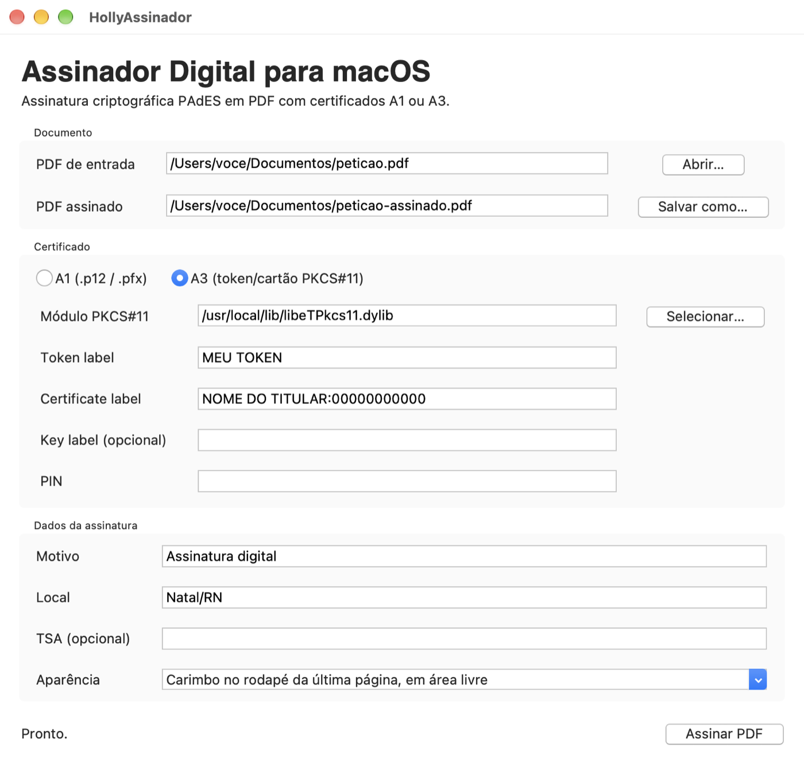

<p align="center">
  
</p>

<h1 align="center">HollyAssinador</h1>

<p align="center">Assinador digital de PDF para macOS: PAdES com certificado A1 (arquivo) ou A3 (token/cartão), tudo local.</p>

> **Parte da suíte Holly**  
> Ferramentas local-first para texto, documentos e mídia, com privacidade por padrão e segurança verificável.  
> [HollyOCR](https://github.com/HollyGM/HollyOCR) · [HollyTranscrição](https://github.com/HollyGM/HollyTranscricao) · [HollyCorretor](https://github.com/HollyGM/HollyCorretor) · [HollyOptimizer](https://github.com/HollyGM/HollyOptimizer) · [Texto em Áudio](https://github.com/HollyGM/HollyTextoEmAudio) (voz online)

<p align="center">
  
</p>

## O que faz

- Assinatura criptográfica **PAdES** (SHA-256) gravada dentro do PDF, de forma incremental: o documento original não é reescrito e assinaturas anteriores continuam válidas.
- Certificado **A1** (`.p12` / `.pfx`) ou **A3** via **PKCS#11** (token ou cartão).
- **Aparência da assinatura:** invisível (padrão) ou um carimbo pequeno no rodapé da última página, **sempre em área livre**, sem cobrir o texto.
- Motivo, local e carimbo do tempo (RFC 3161) opcional por URL de TSA.
- Lembra as configurações (caminhos e labels do token), **nunca a senha nem o PIN**.

## Privacidade e segurança

- Tudo roda no seu Mac. O app **só usa a rede se você informar uma TSA**; o autoteste completo de assinatura foi executado com toda a rede bloqueada pelo sistema.
- A chave do A3 nunca sai do token; a do A1 só é carregada durante a assinatura.
- Senha do A1 e PIN do A3 não são gravados nem registrados em log.
- O `.gitignore` do projeto impede que certificados e chaves (`.p12`, `.pfx`, `.pem`, `.key`...) sejam versionados por engano. Veja também o [SECURITY.md](SECURITY.md).

## O que o app **não** faz

- Não valida a cadeia de certificação ICP-Brasil nem gera assinaturas com política ICP-Brasil (AD-RB/AD-RT) ou LTV. A assinatura é PAdES básica, com carimbo do tempo se uma TSA for informada.
- Não assina em lote nem integra com navegador. Uma integração web precisaria de autenticação forte, controle de `Origin` e confirmação do usuário a cada documento; não exponha uma porta local que assine sem isso.
- O carimbo visível só vai na última página e é desativado (a assinatura sai invisível, com aviso) se não houver área livre ou se a página estiver girada.
- Só macOS. Desenvolvido em Apple Silicon.
- Projeto independente: sem vínculo com tribunais, ITI/ICP-Brasil, Adobe ou fabricantes de token. Não é assessoria jurídica; confira se o seu destino aceita o tipo de assinatura.

## Instalação

Ainda não há binário publicado. Gere o aplicativo no seu Mac:

```bash
git clone https://github.com/HollyGM/HollyAssinador.git
cd HollyAssinador
./build_macos.sh
```

O app fica em `dist/HollyAssinador.app`; arraste-o para `/Applications`. Para testar sem gerar o `.app`: `./run_dev.sh`.

**Python:** precisa de 3.10+ **com tkinter**. O `python3` mais novo do Homebrew (3.13+) não inclui tkinter; os scripts escolhem sozinhos um Python adequado, e você pode instalar um com `brew install python@3.12 python-tk@3.12`. Para forçar um: `PYTHON_BIN=/caminho/python3.12 ./build_macos.sh`.

**Gatekeeper:** o app é assinado apenas de forma *ad hoc*. Ele abre no Mac onde foi gerado; em outros, o Gatekeeper vai reclamar. Para distribuir, assine com Developer ID e notarize (`codesign`, `notarytool`, `stapler`).

## Como usar

### Certificado A1

1. Escolha o PDF e o nome do arquivo assinado.
2. Selecione `A1`, o arquivo `.p12`/`.pfx` e digite a senha.
3. Clique em **Assinar PDF**.

### Certificado A3 (token/cartão)

Informe o módulo PKCS#11 do fabricante (`.dylib`), o *token label* e o *certificate label*. O *key label* pode ficar vazio: a chave privada é localizada pelo ID do certificado (convenção do PKCS#11). O PIN é digitado a cada assinatura.

Locais comuns do módulo: `/Library/Frameworks/`, `/Library/Application Support/`, `/usr/local/lib/`, `/opt/homebrew/lib/`. Tokens SafeNet eToken com o SafeNet Authentication Client usam `/usr/local/lib/libeTPkcs11.dylib`.

Para descobrir os labels, conecte o token e rode:

```bash
source .venv/bin/activate
python probe_pkcs11.py "/caminho/do/modulo.dylib"
```

### Aparência da assinatura

- **Invisível (padrão):** nada é desenhado no PDF. Leitores como o Adobe Acrobat mostram a barra "Assinado e todas as assinaturas são válidas" e o painel de assinaturas.
- **Carimbo no rodapé:** o app renderiza a última página, procura um retângulo sem conteúdo no quarto inferior (alinhado à margem do texto, acima do número de página) e coloca ali o carimbo. Uma segunda assinatura visível não cobre a primeira.

A representação visual não substitui a assinatura criptográfica: quem garante integridade e autenticidade é a assinatura PAdES embutida no PDF.

### Carimbo do tempo (TSA)

Se você informar a URL de uma TSA compatível com RFC 3161, o app solicita o carimbo do tempo na assinatura. Deixe vazio para a assinatura PAdES básica.

### PDFs com referências cruzadas híbridas

Alguns geradores (por exemplo, o Word ao exportar PDF) produzem arquivos com tabela xref clássica + `/XRefStm`. Por segurança, o pyHanko recusa assiná-los no modo estrito. O app tenta primeiro no modo estrito e **só nesse caso** assina em modo tolerante, avisando na mensagem de sucesso. Alguns validadores estritos (inclusive o pyHanko em modo estrito) podem recusar validar o resultado.

## Configurações lembradas

Ficam em `~/Library/Application Support/HollyAssinador/config.json` (permissão 600): caminhos, labels do A3, motivo, local, TSA, tipo de certificado e aparência. Apague o arquivo para voltar ao padrão.

## Para quem quer ajudar

Contribuições são bem-vindas: issues, correções, testes e documentação. Boas frentes:

- testes automatizados e CI;
- validação da assinatura dentro do app e perfis de assinatura (PAdES-LT/LTA, políticas ICP-Brasil);
- teste com outros tokens/cartões e relatos de módulos PKCS#11 que funcionam;
- assinatura e notarização do `.app`; empacotamento (`.dmg`);
- posição do carimbo configurável e assinatura em lote.

**Estrutura:** `app.py` (interface Tkinter) · `signer_core.py` (assinatura com pyHanko) · `placement.py` (área livre para o carimbo, via pypdfium2) · `settings.py` (configurações) · `selftest.py` · `assets/` (logo; `make_icon.swift` regenera o ícone com `swift assets/make_icon.swift assets`).

**Autoteste:** `HollyAssinador.app/Contents/MacOS/HollyAssinador --self-test` assina um PDF temporário com um certificado temporário e confere pyHanko, pdfium e PKCS#11 empacotados. O `build_macos.sh` roda esse teste no final e falha se algo estiver quebrado.

## Licença

Distribuído sob a [Licença Apache 2.0](LICENSE). Os componentes de terceiros estão listados em [THIRD_PARTY_NOTICES.md](THIRD_PARTY_NOTICES.md); o núcleo usa o [pyHanko](https://github.com/MatthiasValvekens/pyHanko) (MIT).
